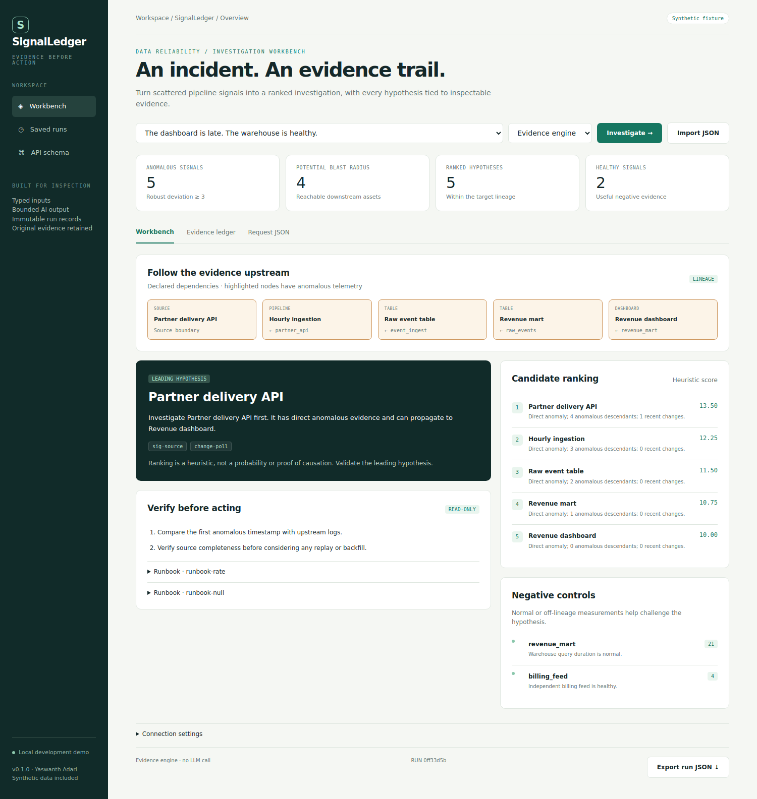

# SignalLedger

**An evidence-grounded incident copilot for data platforms.**

Python 3.11+ · FastAPI · SQLite · optional local Ollama · MIT

A late dashboard can be caused by a slow source, a retrying ingestion job, or a schema change. An alert tells you where a symptom appeared; an investigation needs evidence about where it began.

SignalLedger is a working local portfolio application with a browser workbench, typed HTTP API, saved runs, repeatable synthetic scenarios, and a real Ollama adapter. The default evidence engine runs without a model or API key. Select **Local AI / Ollama** to enable model inference.

## Architecture

The main diagram is the **proposed AWS deployment**: service icons, network boundaries, and labeled data and deployment paths. The cloud services are a design target; this release runs locally.


[Full-resolution PNG](docs/assets/architecture.png) · [Editable cloud diagram](docs/assets/architecture.drawio) · [Cloud design and implementation gaps](docs/CLOUD_DESIGN.md)

The [runnable implementation diagram](docs/assets/implementation.png) maps the actual FastAPI, Python engine, SQLite, and optional Ollama components. See the [low-level design](docs/LLD.md) for contracts, algorithms, and failure behavior, and the [layered component view](docs/assets/layers.png) for module boundaries.

Open the `.drawio` files in [diagrams.net](https://app.diagrams.net/) to edit individual service icons, labels, and connectors. The repository includes SVG and PNG exports; [diagram sources and icon attribution](docs/assets/README.md) explain how to reproduce them.

## Why this project

- **Lineage-aware investigation:** constrain hypotheses to ancestors of the affected asset and calculate potential downstream impact.
- **Explainable anomaly scoring:** median/MAD baselines, directional metrics, and a visible ranking formula.
- **Evidence-constrained AI:** a local model may explain a candidate; unknown candidates or citation IDs fail validation.
- **Negative evidence:** retain healthy measurements that challenge a convenient explanation.
- **Explicit abstention:** healthy or insufficient evidence produces no invented root cause.

## Run in two minutes

From this repository directory:

```bash
python -m venv .venv
source .venv/bin/activate
python -m pip install -e '.[dev]'
python -m uvicorn signalledger.api:app --host 127.0.0.1 --port 8011
```

On Windows PowerShell, activate with `.venv\Scripts\Activate.ps1` instead.

Open **http://127.0.0.1:8011**. Select a scenario, inspect the results, open the evidence ledger, and export the saved report. **Request JSON** lets you edit the inputs; **Import JSON** accepts your own request.



### Optional local AI

Install [Ollama](https://ollama.com/), start it, and pull a model:

```bash
ollama pull llama3.2
export OLLAMA_URL=http://127.0.0.1:11434
export OLLAMA_MODEL=llama3.2
```

Then launch the app from that same terminal and select **Local AI / Ollama**. Model availability and hardware requirements depend on your machine. The app sends supplied evidence to that configured endpoint. There is no cloud API key. Invalid or unavailable AI output falls back to the evidence engine, with a visible status.

The adapter uses Ollama's [structured-output API](https://docs.ollama.com/capabilities/structured-outputs). Schema and domain checks run again after the response. This validates references, not the truth of every sentence.

### Docker

```bash
docker compose up --build
```

Compose binds the app to localhost and persists SQLite in a named volume. It uses `host.docker.internal:11434` for an Ollama process on the host. Docker configuration is supplied; container execution was not tested in the authoring environment.

## Reproduce the results

```bash
python -m pytest -q
python scripts/evaluate.py
```

The evaluation script asserts expected outcomes and writes [evaluation.json](docs/evaluation.json). These are small, designed synthetic scenarios, not a production benchmark or an LLM quality study. See [validation scope](docs/VALIDATION.md).

| Scenario | Expected leading hypothesis |
| --- | --- |
| Upstream rate limit / stale dashboard | `partner_api` |
| Payload rename / null spike | `raw_events` |
| Healthy telemetry / noisy alert | Abstain |

## API and CLI

```bash
curl -X POST http://127.0.0.1:8011/api/investigations \
  -H 'Content-Type: application/json' \
  -H 'Idempotency-Key: demo-001' \
  --data-binary @examples/01-source-delay.json

python -m signalledger examples/01-source-delay.json
```

| Endpoint | Purpose |
| --- | --- |
| `GET /api/health` | Process health |
| `GET /api/scenarios` | Included fixture catalog |
| `GET /api/scenarios/{id}` | Full fixture request |
| `POST /api/investigations` | Validate, analyze and save a run |
| `GET /api/investigations` | Latest 30 run IDs and timestamps |
| `GET /api/investigations/{id}` | Full saved report |
| `GET /openapi.json` | Generated OpenAPI contract |

An `Idempotency-Key` retry with the same normalized request returns the same persisted run. Reusing the key for different input returns `409`. CLI output is ephemeral JSON; it does not write the run database.

## Design decisions and scope

- **One service first.** Domain logic is pure and separate from transport, persistence, and model I/O. A queue and multiple services would add operating cost without improving this bounded demo.
- **SQLite WAL.** Useful for reproducible local runs; not a claim of distributed durability or multi-tenant isolation.
- **No paid infrastructure required.** Evidence mode uses no model; local inference uses your own hardware.
- **Synthetic data only.** No employer logs, schemas, credentials, or business information are included.
- **Advisory behavior.** No pipeline remediation is executed.

This is a local development release. Before internet exposure, add real identity and authorization, rate limiting, worker isolation, TLS, data retention controls, and operational monitoring. `APP_TOKEN` is a small optional local API guard, not multi-tenant authentication. Production connectors, scheduled ingestion, managed hosting, and live LLM quality evaluation are roadmap items.

## Explore the engineering

- [AWS deployment blueprint and migration plan](docs/CLOUD_DESIGN.md)
- [Low-level design, data model, algorithms and failure semantics](docs/LLD.md)
- [Validation record and explicit limitations](docs/VALIDATION.md)
- [Demo script and LinkedIn showcase notes](docs/SHOWCASE.md)
- [Source scenarios](examples/)
- [Tests](tests/)

Created for [Yaswanth Adari](https://github.com/YaswanthAd) · [MIT license](LICENSE) · [Third-party icon notices](docs/assets/icons/ATTRIBUTION.md)

## Companion project

Explore [ContractForge](https://github.com/YaswanthAd/contractforge-ai) for the other half of this AI and data-engineering portfolio.
