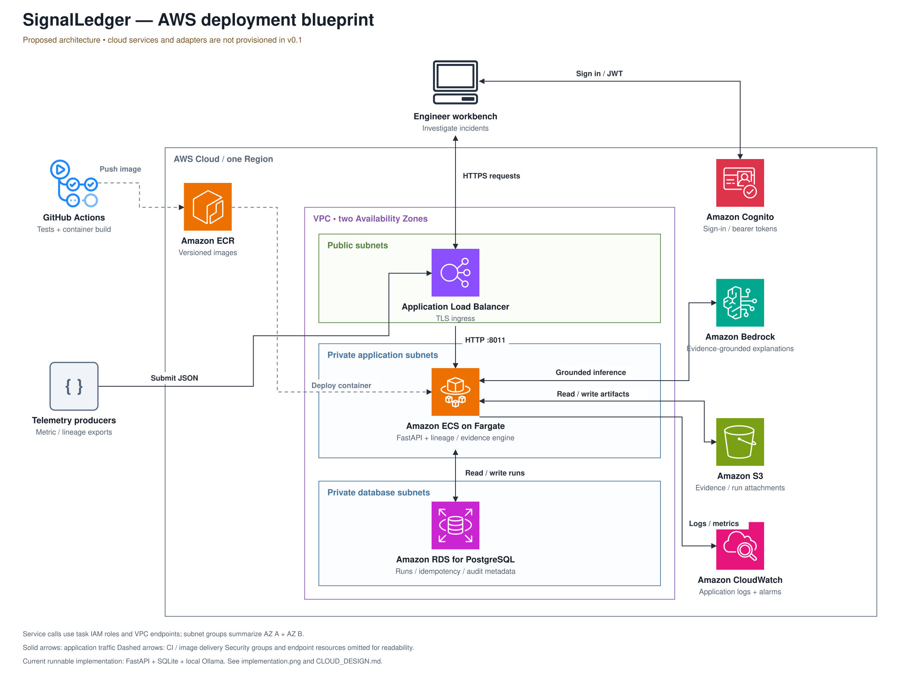

# SignalLedger — AWS deployment design

**Status: proposed design, not deployed.** The runnable release uses FastAPI, SQLite, and an optional Ollama HTTP adapter. No AWS infrastructure, AWS SDK integration, managed identity, or cloud delivery workflow is included. The diagram makes the intended deployment reviewable before implementation.

[Editable source](assets/architecture.drawio) · [Actual implementation](assets/implementation.png) · [Low-level design](LLD.md)

## Layers and implementation map

| Layer | Runs today | Proposed AWS component | Work required |
| --- | --- | --- | --- |
| Experience | Same-origin HTML/CSS/JS workbench | Workbench served by the application | Add a login flow and per-user saved-run access |
| Identity | Optional local `APP_TOKEN` | Amazon Cognito | Validate JWT signature, issuer, token use, intended client/resource and expiry; authorize every report lookup |
| Ingress | Uvicorn on localhost:8011 | Public Application Load Balancer | ACM certificate, DNS, HTTPS listener, private IP target group and health checks |
| Application | `signalledger/api.py`, `models.py`, `engine.py` | Amazon ECS on Fargate | Task/service definitions, two-AZ subnets, health checks, concurrency and resource limits |
| Inference | `llm.py` → operator-configured Ollama | Amazon Bedrock | New provider adapter, model-specific request mapping, bounded response handling and domain validation |
| Structured persistence | `store.py` → local SQLite/WAL | Amazon RDS for PostgreSQL | New store implementation, migrations, TLS connections, atomic idempotency and scoped queries |
| Large artifacts | JSON held inside a bounded report | Amazon S3 | Private bucket, encryption, retention policy and explicit object ownership |
| Observability | Process health and server logs | Amazon CloudWatch | Redacted structured logs, correlation IDs, inference/fallback metrics and alarms |
| Delivery | Test workflow, Dockerfile and Compose | GitHub Actions → Amazon ECR → ECS | Image build/scan/push, restricted OIDC deploy role, digest-based rollout and rollback |

## Request and data paths

1. The workbench obtains a token from Cognito. Its HTTPS API request reaches the ALB; the application validates identity and authorization. Machine callers need a separately scoped service identity.
2. The ALB terminates TLS and forwards HTTP on port 8011 to private Fargate tasks. The task security group accepts application traffic only from the ALB security group. The drawing summarizes both Availability Zones; it does not mean a single subnet spans zones.
3. Typed validation and the deterministic domain engine run in the application process. A PostgreSQL transaction owns the normalized request digest and per-identity idempotency key. Concurrent requests can still duplicate computation unless a job reservation is added; persistence uniqueness alone does not promise exactly-once inference.
4. If AI is requested, a Bedrock adapter sends only the selected input context. Its response must pass the same schema and domain gate as the local provider. The model cannot execute arbitrary code or issue infrastructure commands.
5. The application saves a bounded report in PostgreSQL. Larger inputs and attachments may be stored in private S3 objects after data-retention requirements are defined. A report becomes visible only after its required references are durable; use explicit staging and garbage collection for failed partial writes.
6. The workbench reads the saved result through the authorized API. Redacted logs and operational counters go to CloudWatch. Raw prompts, credentials and event payloads should not be default log fields.

## Network and permission boundaries

- Public subnets contain the internet-facing load balancer. Fargate tasks and PostgreSQL are in private subnet groups across two Availability Zones.
- Use an ECS execution role for ECR image pulls and log delivery, and a separate task role for narrowly scoped Bedrock, S3 and database-secret access. GitHub Actions uses a distinct OIDC deployment role.
- Private tasks need the relevant VPC endpoints: ECR API and Docker registry interface endpoints, an S3 gateway endpoint for image layers/artifacts, and interface endpoints for Bedrock Runtime, CloudWatch Logs and Secrets Manager where used. DNS, endpoint policies and security groups are part of that implementation; they are omitted from the overview image.
- Permit database connections only from the task security group and require encrypted PostgreSQL connections. Use private S3 access with public access blocked. Obtain Cognito signing keys through a deliberate HTTPS egress path, such as a NAT gateway, and cache/rotate keys safely.
- The browser handles sign-in; the API must independently verify the token and authorize the action. `APP_TOKEN` cannot supply this boundary.

## Delivery and failure behavior

The target delivery path tests the code, builds a non-root image, scans it, pushes it to ECR and updates ECS with an immutable image digest. Keep the previous digest for rollback and run database migrations as a controlled step with backward-compatible schema changes. The current workflow runs Python tests only.

For an initial bounded synchronous service, choose a provider deadline shorter than the ALB request budget, bound concurrent model calls and return explicit fallback status on provider failure. Bedrock model capacity and context limits need measurement; the local Ollama settings are not a cloud performance guarantee. Move longer work to durable queued jobs with polling, cancellation, retry budgets and a dead-letter policy before increasing batch size. That queue is not part of this diagram or implementation.

Restore-tested backups, storage limits, cost budgets, data deletion, log retention and incident alerts are deployment acceptance criteria. The diagram is not a capacity estimate, availability guarantee or production certification. No paid resources have been created.

## Build sequence

1. Introduce and test PostgreSQL and Bedrock adapters behind the existing engine boundary.
2. Add Cognito identity, report ownership, authorization tests, retention and request budgets.
3. Define VPC, endpoints, ALB, ECS, ECR, RDS, S3 and IAM in infrastructure as code; validate it in a sandbox account.
4. Add image delivery, health-gated rollout and rollback. Verify network isolation, failure modes, backups and actual inference quality with synthetic data.
5. Add real connectors only after the data owner agrees on payload scope and retention.

## Reference documentation

- [AWS architecture icons](https://aws.amazon.com/architecture/icons/)
- [ECS inbound networking and load balancers](https://docs.aws.amazon.com/AmazonECS/latest/developerguide/networking-inbound.html)
- [ECS service load balancing](https://docs.aws.amazon.com/AmazonECS/latest/developerguide/service-load-balancing.html)
- [Bedrock private connectivity](https://docs.aws.amazon.com/bedrock/latest/userguide/vpc-interface-endpoints.html)
- [VPC interface endpoints](https://docs.aws.amazon.com/vpc/latest/privatelink/create-interface-endpoint.html)

- [ECR private image-pull endpoints](https://docs.aws.amazon.com/AmazonECR/latest/userguide/vpc-endpoints.html)
- [Cognito token verification](https://docs.aws.amazon.com/cognito/latest/developerguide/amazon-cognito-user-pools-using-tokens-verifying-a-jwt.html)
