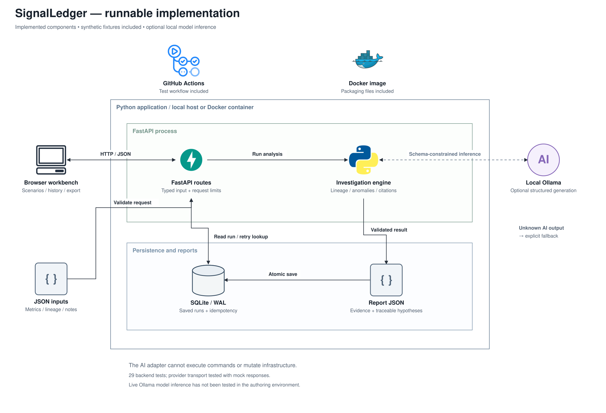

# SignalLedger — low-level design

## Objective and non-goals

Given a declared asset DAG, recent measurements, and supporting notes, rank plausible upstream explanations for an affected asset. Produce a checkable report with evidence IDs, normal controls, and potential downstream impact. A local model may add a narrative, but the domain engine works independently.

This release does not prove causality, poll live infrastructure, execute remediation, estimate dollars saved, or train a model. A measurement is a point compared with a supplied baseline, not a full time-series detector. The rank is not a calibrated probability.

[Editable implementation diagram](assets/implementation.drawio) · [Layered module view](assets/layers.png) · [Proposed AWS deployment](CLOUD_DESIGN.md)

## Domain contracts

| Model | Fields and invariants |
| --- | --- |
| `Asset` | Unique ID, human label, source/pipeline/table/dashboard kind, existing parent IDs |
| `Signal` | Unique evidence ID, existing asset, metric, finite nonnegative observation, 5–168 finite baseline values, timezone-aware timestamp, detail |
| `Note` | Unique evidence ID, existing asset, change/log/runbook kind, text, timezone-aware timestamp |
| `Investigation` | Title, existing target, question, 1–60 assets, 1–200 signals, up to 100 notes, rules/ollama mode |
| `AIExplanation` | Known candidate, summary, evidence IDs, verification checks, uncertainty caveat |

Metric values are capped at 1e15 to avoid numeric overflow; null fractions must be between 0 and 1. Model configuration rejects extra fields and NaN/Infinity. Asset parents are unique; DFS rejects cycles. Evidence IDs are unique across signals and notes.

## Investigation algorithm

1. Build an ID-indexed DAG. Traverse the target's ancestors, including the target itself. Anomalies outside that set cannot become a cause for this investigation.
2. For every signal, calculate median `m` and median absolute deviation `MAD`. Set `scale = max(1.4826 × MAD, abs(m) × 0.05, metric_floor)`. Floors: 0.005 for null fraction, 1 for errors/row count, 0.5 for other metrics.
3. Compute one-sided deviation `z = max(0, direction × (observed − m) / scale)`. Direction is −1 for row count and +1 otherwise. Mark `z >= 3` anomalous. Increased row count and decreased duration are not detected by this intentionally one-sided model.
4. Rank each anomalous ancestor: `min(max_local_z, 10) + 0.75 × anomalous_descendant_count + 0.5 × has_recent_change`. A change counts when it precedes a signal on that asset by at most 60 minutes. Break ties by asset ID for reproducibility.
5. Use BM25 token retrieval over supplied, in-lineage runbooks, return up to three positive-scoring documents. BM25 uses `k1=1.2`, `b=0.75` and tokenized lowercase text. No embeddings or remote vector database are implied.
6. Preserve normal measurements and off-lineage measurements as controls. A reported blast radius means reachable downstream assets, not confirmed failures. All evidence remains inspectable.
7. If no eligible anomalous nodes exist, abstain and skip any model request.

Repeated graph traversals are appropriate for the 60-node bound, but not an optimized graph database. Traversal is O(V+E); computing descendants for many nodes makes the overall ranking approach approximately O(V(V+E)+S+N) at this scale. BM25 scans the small supplied note corpus for each query token.

## AI acceptance rule

Only the top five ranked candidates are offered to the model. Context includes relevant signals, non-runbook notes, retrieved runbooks, and the allowed evidence IDs. The model response must satisfy `AIExplanation`, choose one offered candidate, cite only allowed IDs, and cite at least one direct piece of that candidate's evidence. On rejection or provider failure, retain the deterministic report.

These checks prevent invented references and unsupported candidate selection. They do not establish that a fluent sentence is entailed by a cited observation. Recommended checks are advisory text and are never executed. The report makes that limitation visible.

## Report assembly

The report includes title/target, `hypothesis` or `insufficient_evidence` status, selected analyst, AI status/error, summary, caveat, checks, candidate scores, cited IDs, all scored signals, controls, notes, runbooks, asset graph, blast radius, and an actual-time-sorted timeline. API persistence adds UUID and creation time; the store separately records the canonical input hash.

## Persistence model

One SQLite `reports` table stores `id TEXT PRIMARY KEY`, `idem_key TEXT UNIQUE NOT NULL`, `digest TEXT`, `created_at TEXT`, and serialized `payload TEXT`. `digest` is SHA-256 over sorted compact JSON of the Pydantic-normalized input. IDs are UUID4; timestamps are UTC. Each saved payload also carries the normalized request and its digest for reproducible inspection.

Every connection is explicitly closed. WAL is enabled at initialization. Writes use `BEGIN IMMEDIATE` and a 15-second SQLite busy timeout. The unique key is checked inside the write transaction. Requests with the same key and same input return the original saved record; differing input produces HTTP 409. The API exposes no update/delete operation. This is application immutability, not tamper-proof storage.

Analysis happens before the write lock. Two simultaneous identical requests can duplicate computation or model calls; only one report is persisted. Exactly-once model execution is not claimed. Stored reports have no retention job yet. A local operator owns the database and its backups.

## Model boundary

`llm.generate` makes one HTTP POST to the operator-configured `OLLAMA_URL` plus `/api/chat`. The caller cannot supply a provider URL in the request. `OLLAMA_MODEL` selects the model; `llama3.2` is the example default, not an automatically downloaded dependency.

The body includes a JSON response schema, `stream: false`, temperature 0, and a 1,600-token prediction budget. HTTP connect timeout is 3 seconds and read/write/pool timeout is 60 seconds. This is an inactivity timeout, not a hard wall-clock deadline. Response reading stops above 128,000 bytes. Redirects and environment proxy inheritance are disabled. Provider transport errors and malformed outputs produce an explicit fallback status.

The system prompt treats supplied content as untrusted data. This is not a proof of prompt-injection immunity. No tools, shell execution, SQL execution, or network actions requested by the model exist. User-visible model prose may still be wrong. The server logs no prompt or credential by design; SQLite persists the report evidence.

## API boundary and failures

| Condition | Behavior |
| --- | --- |
| Input body over 2 MiB, including chunked uploads | HTTP 413 |
| Invalid Pydantic request | HTTP 422 |
| `APP_TOKEN` configured, token absent or invalid | HTTP 401 on protected `/api/*` |
| Reused idempotency key for different normalized input | HTTP 409 |
| Missing scenario or saved report | HTTP 404 |
| Model unavailable / invalid output | HTTP 200 with evidence fallback and explicit `ai_status` |
| Unexpected runtime / database failure | Server error; never reported as a successful saved run |

The health route, static UI and OpenAPI schema remain public even with `APP_TOKEN`. No CORS middleware is enabled. The UI talks to the same origin and keeps its optional bearer token in page memory. Dynamic content is HTML-escaped. CSP restricts scripts and styles to the same origin and disallows framing.

The request-size limit does not cap request duration. This local service has no slow-client defense, rate limit, per-user authorization, background queue, cancellation endpoint, or retention controls. Bind to localhost as documented. Public hosting requires those additional boundaries and an authenticated reverse proxy.

## Deployment and operations

One Uvicorn process serves the application. The Docker image runs as UID 10001 and writes SQLite to `/data`; Compose mounts a named volume and binds the host port to 127.0.0.1. Ollama is a separate process reachable through an explicit endpoint. The model is optional and not bundled.

No Kubernetes, Kafka, Snowflake, Airflow, or managed-cloud resources are provisioned. The README's AWS blueprint is a separate, unimplemented deployment target; see [CLOUD_DESIGN.md](CLOUD_DESIGN.md) for the service mapping and required adapters. Production evolution would move long model calls into a durable queue, isolate workers, use PostgreSQL and object storage, add OIDC/authorization and telemetry, and define deletion/retention requirements before ingesting real logs.

## Complexity and operating limits

Payloads are bounded at 2 MiB. Model context is bounded further by domain selection; context-window fit still depends on the chosen model. Synchronous FastAPI handlers run through its thread-pool path; enough simultaneous model calls can saturate it. This release is for one developer and small replay/investigation batches, not a measured concurrency target.

## Source map

| File | Responsibility |
| --- | --- |
| `models.py` | Typed contracts and semantic input validation |
| `engine.py` | Pure domain analysis and model-output gate |
| `llm.py` | Ollama HTTP transport and resource budget |
| `store.py` | SQLite persistence and idempotency |
| `security.py` | Body limit, optional bearer guard, response headers |
| `api.py` | Routes, orchestration, error mapping, static mounting |
| `web/` | Browser workbench, JSON import/export, run history |
| `__main__.py` | Ephemeral command-line execution |
| `tests/` | Domain, HTTP API, persistence and provider contract checks |

See [VALIDATION.md](VALIDATION.md) for what was actually tested.
